<p align="center">
  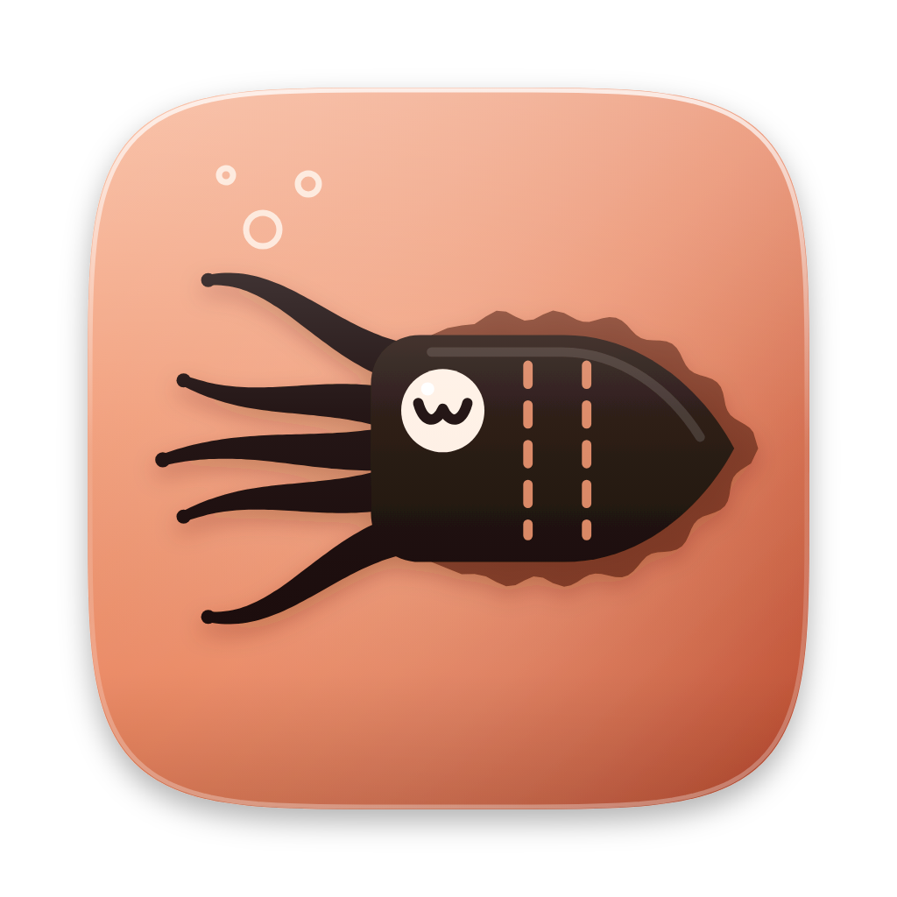
</p>

<h1 align="center">Cuttle: the AI screen recorder that edits itself</h1>

<p align="center">
  <b>Record your screen, or Claude Code at work. Cuttle cuts the waiting, zooms on what matters, masks your secrets and frames it into a demo you can post.</b><br />
  On your computer, for macOS and Windows. A desktop app for people, a CLI and a skill for Claude, and videos written entirely in code.
</p>

<p align="center">
  <a href="LICENSE"></a>
  
  
  
</p>

<p align="center">
  <a href="docs/media/cuttle-promo.mp4">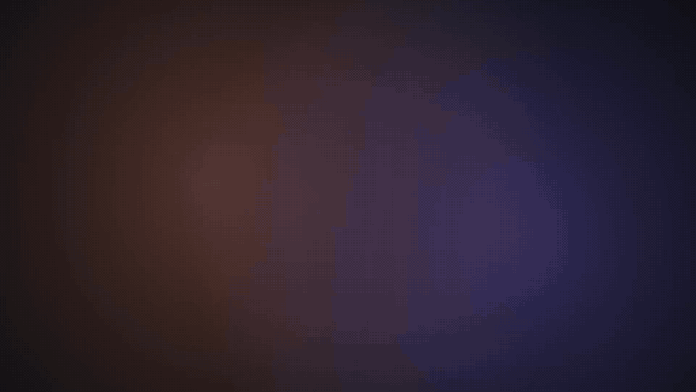</a><br />
  <sub>▶ <a href="docs/media/cuttle-promo.mp4">Watch the whole 40-second video</a>. It was made with Cuttle itself: every frame is a web page written in code, the music too.</sub>
</p>

<p align="center">
  <a href="docs/media/cuttle-0.2-features.mp4">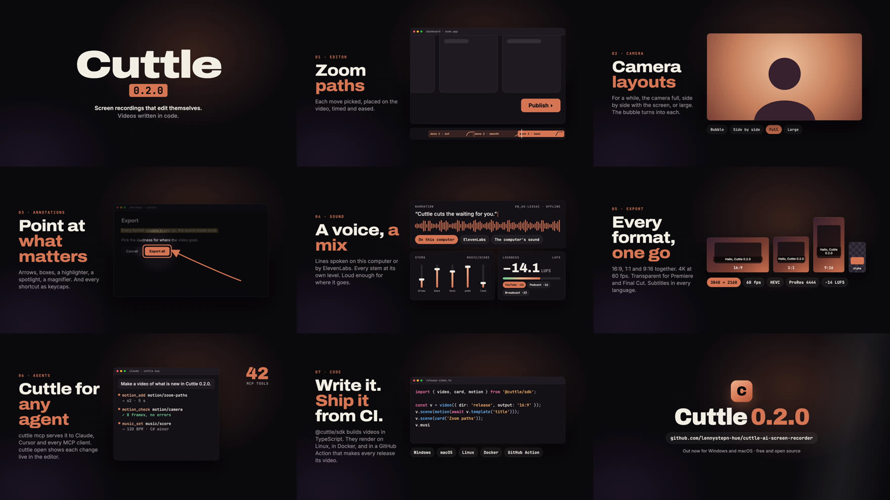</a><br />
  <sub>▶ <a href="docs/media/cuttle-0.2-features.mp4">What is new in 0.2, in 45 seconds</a>. Claude made it through <code>cuttle mcp</code>, as any agent can: nine pages, a score, one render.</sub>
</p>

---

A raw screen recording is mostly waiting: the pause before you start, the moments you look for a
button, five minutes of an agent thinking. Cuttle records the take and then edits it the way a
video editor would. It cuts the idle stretches, speeds up the waiting, zooms in on your clicks and
on what you type, hides API keys, email addresses and notifications, and puts the window on a
designed background with your webcam, subtitles and music. Then it exports an MP4 for X, YouTube,
LinkedIn or Reels. You can change every edit afterwards, in the app or in one plain file
(`cuttle.json`) that Claude Code edits as well.

Or skip the recording altogether: every scene can be a web page you (or Claude) write, and Cuttle
renders it frame by frame into the video, with music composed in code for it. The promo above was
made that way: nine pages and a score, no camera, no editor. See [Motion videos, written in code](#motion-videos-written-in-code).

## What it does

<table>
  <tr>
    <td width="50%">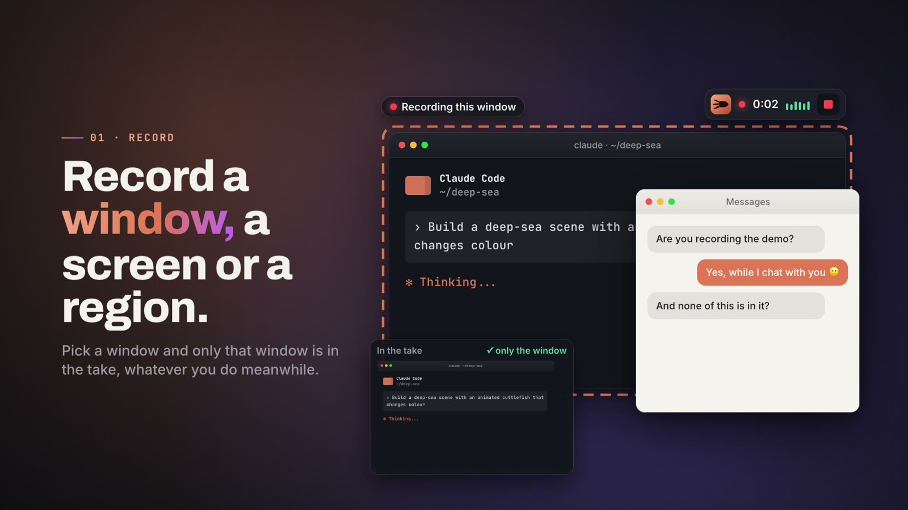</td>
    <td width="50%">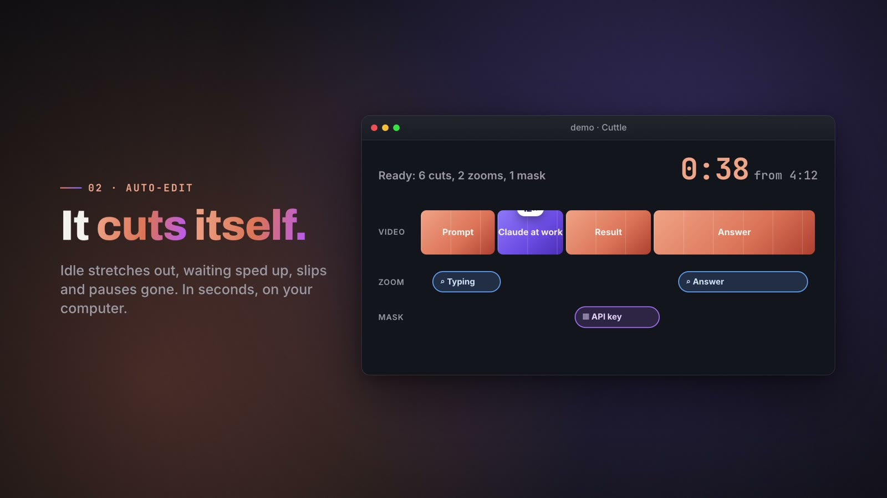</td>
  </tr>
  <tr>
    <td valign="top"><b>Record a window, a screen or a region.</b> With your webcam and mic, the computer's own sound (a video, an app, a game) on a track of its own, a countdown and a small recording bar that never shows in the video. A window take records only that window, also while another one lies over it, so you can keep working (or chatting) beside it. Pause, mark a slip with one key, and keep a script of your steps in a prompter.</td>
    <td valign="top"><b>It cuts itself.</b> Idle stretches out, waiting sped up with a speed badge, slips and long pauses gone, zooms placed where they belong. A take of four minutes becomes a tight demo, in seconds, on your computer.</td>
  </tr>
  <tr>
    <td>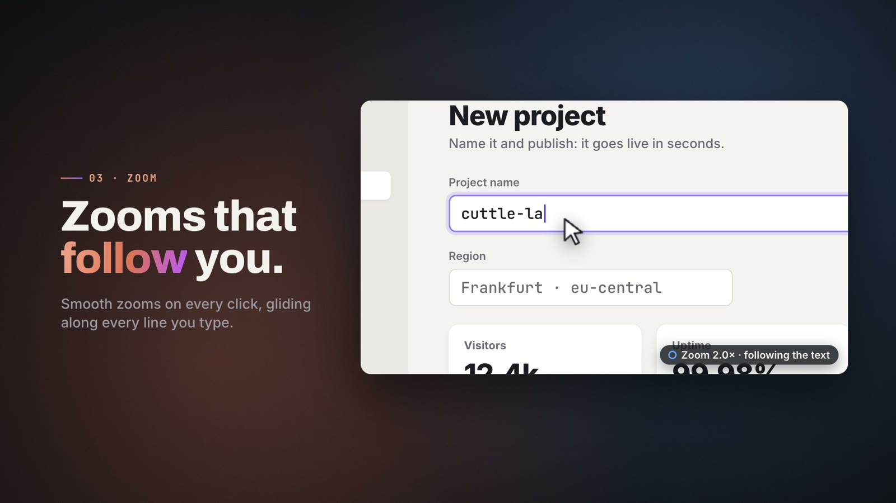</td>
    <td>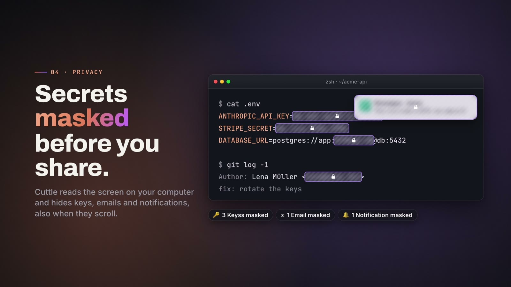</td>
  </tr>
  <tr>
    <td valign="top"><b>Zooms that follow you.</b> Smooth zooms on every click and on dialogs, gliding along each line you type and following the caret. A browser's tabs and bars are cropped away on their own. Point at things with arrows, boxes, a highlighter, a spotlight or a magnifier that draw themselves in.</td>
    <td valign="top"><b>Secrets masked before you share.</b> Cuttle reads the screen's text on your computer (Windows' OCR, macOS's Vision) and masks API keys, tokens, email addresses, IBANs and card numbers, also while they scroll, and every notification that pops up. Add your own words to always hide.</td>
  </tr>
  <tr>
    <td>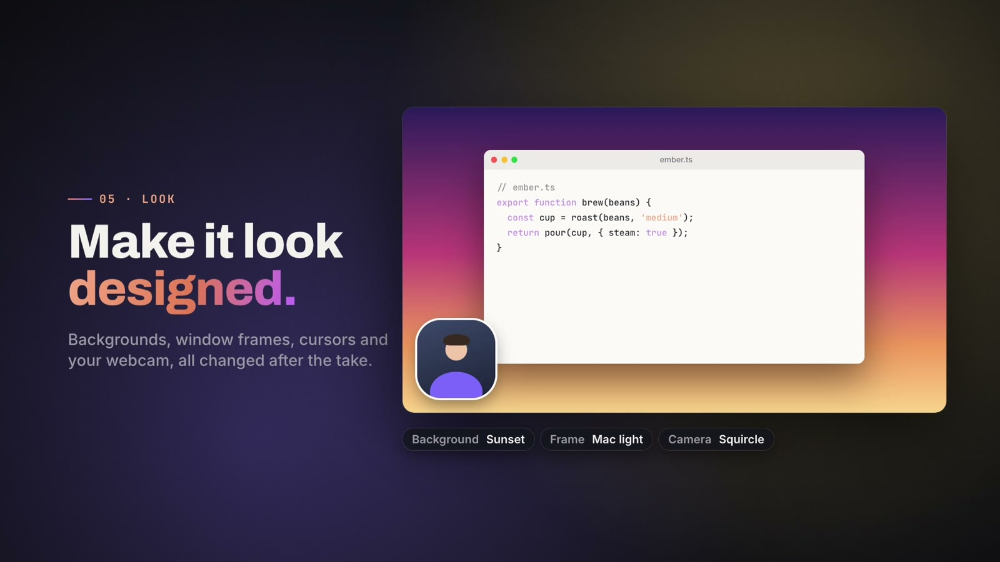</td>
    <td>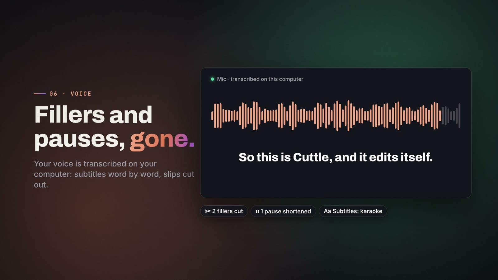</td>
  </tr>
  <tr>
    <td valign="top"><b>Make it look designed.</b> Backgrounds (gradients, animated ones, your wallpaper), window frames from macOS to a phone, cursor styles, keycaps of the shortcuts you press, a webcam bubble you move and reshape after the take, brand kits, watermarks, motion titles and music written for the video.</td>
    <td valign="top"><b>Fillers and pauses, gone.</b> Your voice is transcribed on your computer with Whisper. Filler words and long pauses are cut where the picture rests, subtitles come word by word (or karaoke), and the export writes SRT and VTT. No voice of your own? A narration speaks your text, with neural voices that run on your computer (English, German, French, Spanish) or your ElevenLabs voice by its ID.</td>
  </tr>
  <tr>
    <td>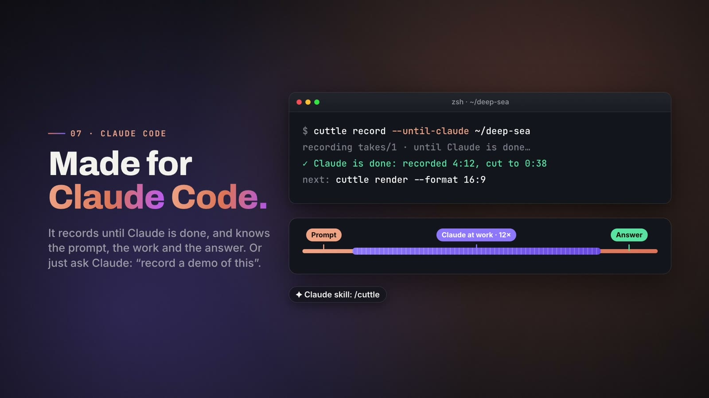</td>
    <td>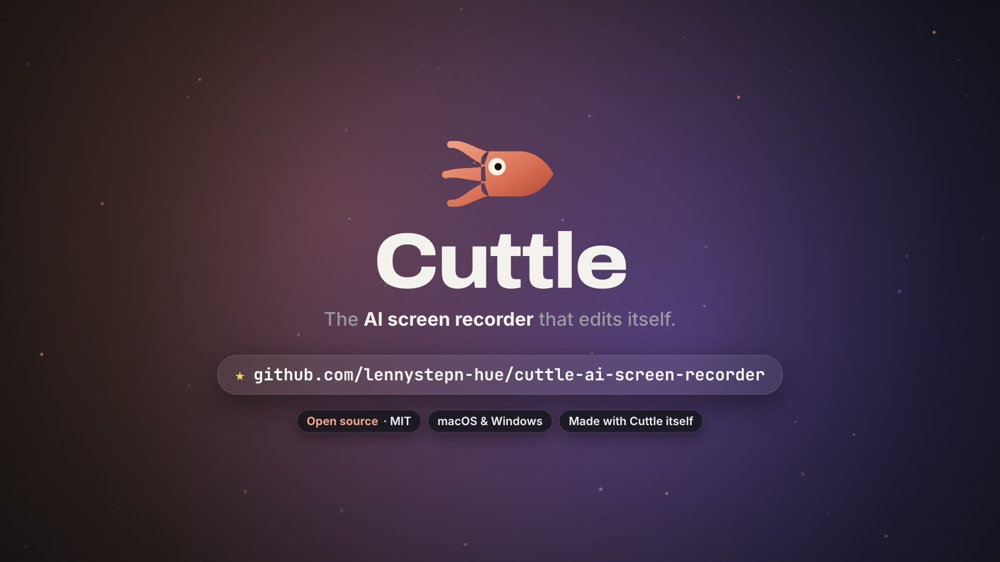</td>
  </tr>
  <tr>
    <td valign="top"><b>Made for Claude Code.</b> <code>cuttle record --until-claude</code> stops when Claude has answered, and Claude's prompt, its tool calls and its answer become markers: the prompt stays readable, the work runs at 12×, the answer gets a zoom. With the skill installed, just ask Claude to record a demo of what it built.</td>
    <td valign="top"><b>Export for every feed.</b> MP4 in 16:9, 1:1 and 9:16 with chapters from your script, rendered by the same WebGL engine the editor shows, frame for frame. Motion scenes (titles, end cards, a 3D laptop, transitions) are web pages Claude can write.</td>
  </tr>
</table>

## The editor

<p align="center">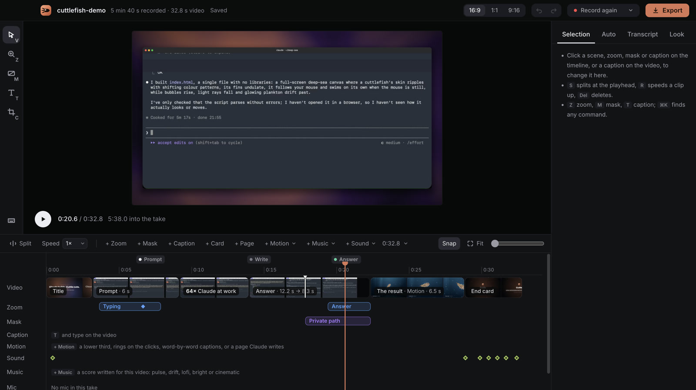</p>

Everything Cuttle did on its own is a normal edit you can change: drag a clip, trim it, set its
speed, move a zoom, redraw a mask, switch a kind of edit off in the Auto tab. The look is a tab of
its own, and the video you see is exactly what the export renders. Drag the inspector's edge or the
timeline's to give the video the room you want, or hide the inspector with ⌘I (Ctrl+I).

<table>
  <tr>
    <td width="50%">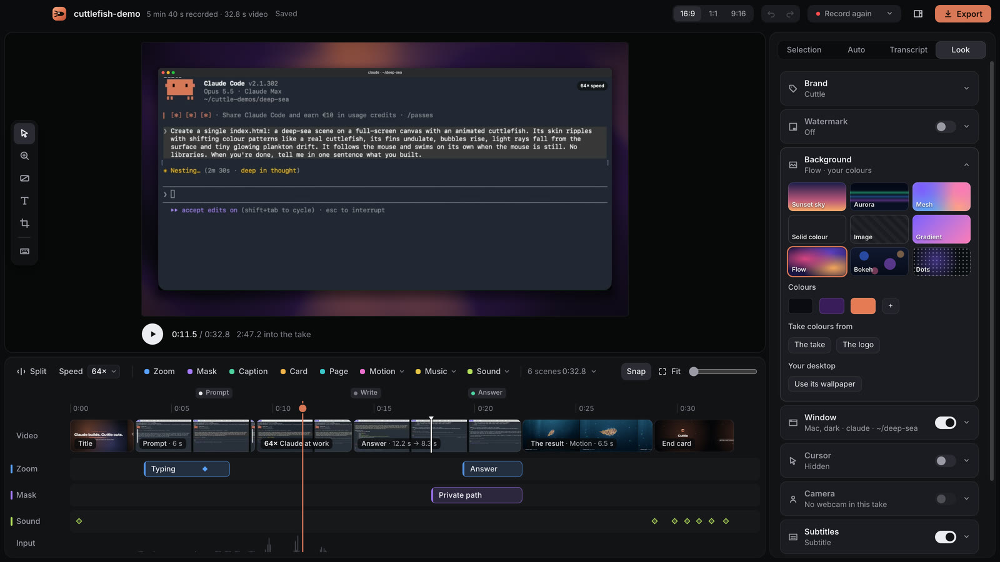</td>
    <td width="50%">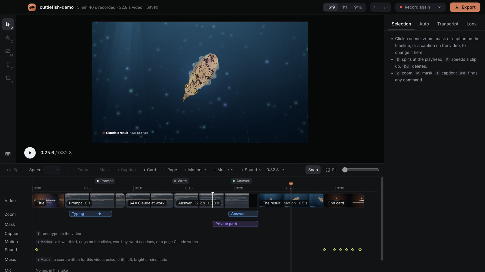</td>
  </tr>
  <tr>
    <td align="center"><sub>The Look tab: backgrounds, frames, cursor, camera, subtitles, sound</sub></td>
    <td align="center"><sub>Motion scenes are web pages, drawn frame by frame (here the page Claude built)</sub></td>
  </tr>
  <tr>
    <td>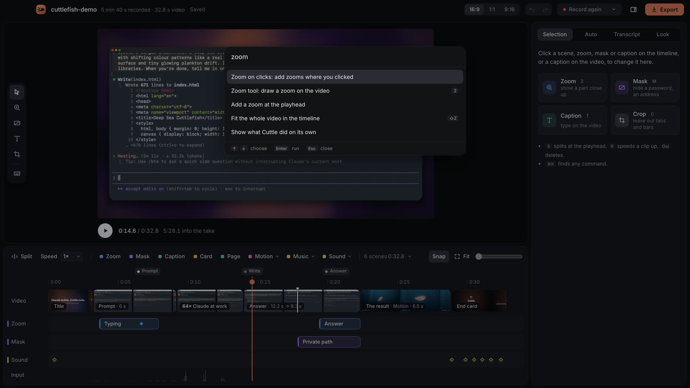</td>
    <td>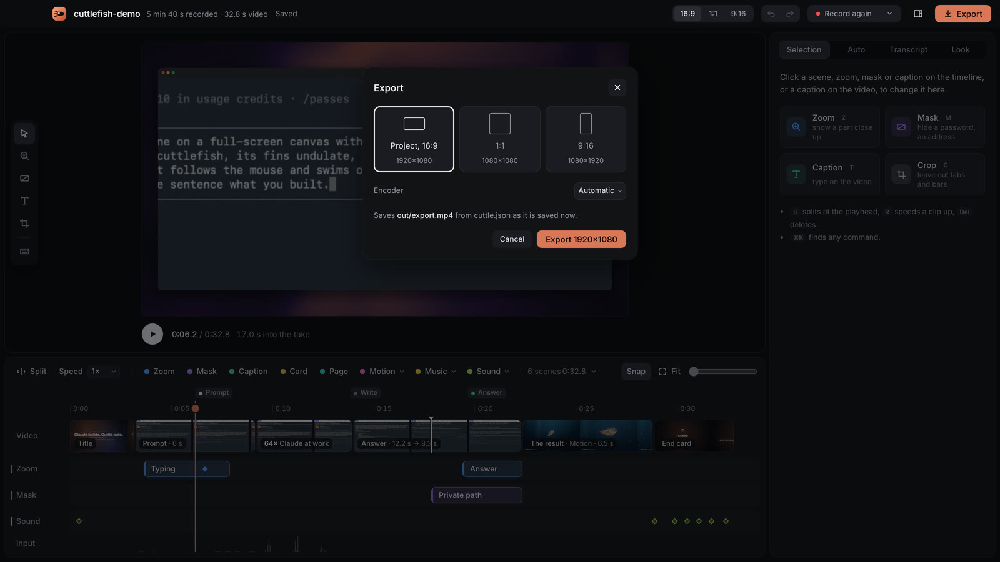</td>
  </tr>
  <tr>
    <td align="center"><sub>Every command and its keys (⌘K / Ctrl+K)</sub></td>
    <td align="center"><sub>Export in 16:9, 1:1 or 9:16</sub></td>
  </tr>
  <tr>
    <td>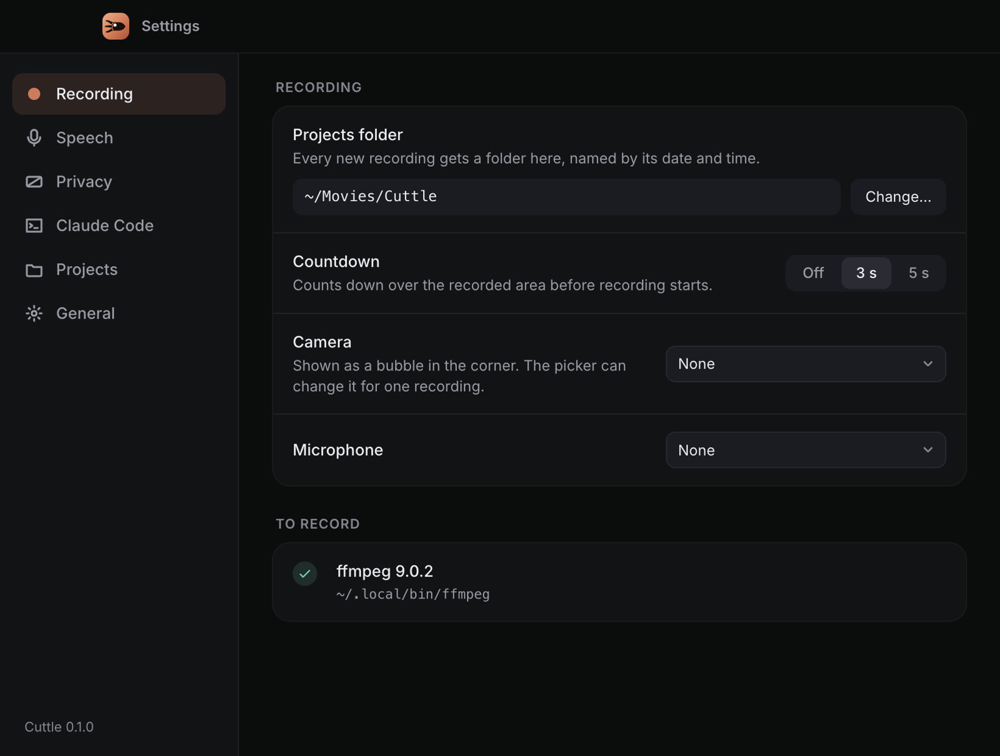</td>
    <td>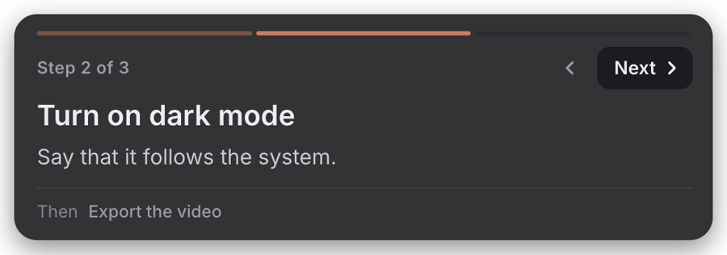<br /><br />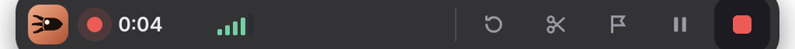</td>
  </tr>
  <tr>
    <td align="center"><sub>Settings</sub></td>
    <td align="center"><sub>The prompter and the recording bar, never in the video</sub></td>
  </tr>
</table>

## Motion videos, written in code

A Cuttle video does not need a recording: a promo, a launch reel, an explainer or a social clip can
be made only of motion scenes. A scene is a web page: kinetic type, a chart that
builds, a code editor that types itself, a laptop in 3D, particles, an After Effects animation
(Lottie), anything HTML, CSS, canvas, SVG, WebGL or Three.js can draw. Cuttle renders the page frame
by frame on the video's own clock, so a render is the same every time, and one page serves 16:9,
1:1 and 9:16. The music is a page too: it composes the score in WebAudio for this
video, from its scenes and cuts, and nothing is licensed or downloaded. Its stems (drums, bass,
keys, pads, lead) each have a level in the editor's mixer, or with `cuttle music set --stem drums=0.5`.

A whole motion video from the command line, from an empty folder to an MP4 (this one renders in
seconds):

```bash
cuttle init launch && cd launch
cuttle motion templates                      # title, end-card, code-typing, device-3d, fold, lower-third, click-callouts, kinetic-captions
cuttle motion new title                      # copies the page into motion/title/ and adds it as a scene
cuttle motion new code-typing                # a file typing itself, with syntax colours and key clicks
cuttle motion new end-card                   # your logo, a line, the URL typing itself
cuttle music new pulse                       # a score for this video (pulse, drift, lofi, bright, cinematic)
cuttle motion check motion/title/index.html  # its frames, a contact sheet, what the page threw
cuttle watch                                 # each page saved checked again, as you write
cuttle music check                           # the music alone: a WAV, its levels, the hits on the cuts
cuttle render --format 9:16 --format 1:1     # out/9x16.mp4 and out/1x1.mp4 in one go; also 16:9
```

<p align="center">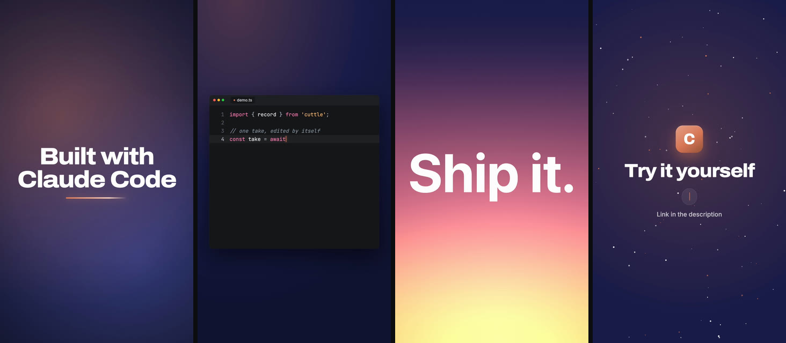<br />
<sub>Four frames of the 16-second 9:16 video these commands make, with the page below as its third scene</sub></p>

The templates are examples, not the limit: any page you (or Claude) write goes into the video with
`cuttle motion add motion/hello/index.html` (a scene; `--as overlay` or `--as transition` for the
other kinds). A page of your own is a few lines. Everything follows the video's time, from 0 at the
scene's start, so a page that draws from `t` is right on every frame:

```html
<!-- motion/hello/index.html, added with: cuttle motion add motion/hello/index.html --after s2 -->
<style>
  body { margin: 0; height: 100vh; display: grid; place-items: center; font: 700 14vmin system-ui; color: white; }
</style>
<h1 id="title">Ship it.</h1>
<script type="module">
  import { at, ease } from 'cuttle';
  const title = document.getElementById('title');
  cuttle.onFrame((t) => {
    const shown = at(t, 0.2, 0.8, ease.outExpo);
    title.style.opacity = shown;
    title.style.transform = `translateY(${(1 - shown) * 60}px)`;
  });
</script>
```

- **The page's world:** `performance.now`, timers, `requestAnimationFrame`, CSS animations and
  `Math.random` (seeded) all follow the frame being drawn. `import … from 'cuttle'` gives easing,
  keyframes, springs, staggering, text splitting, typing with a rhythm and syntax colours, as
  functions of time; Three.js and Lottie come with the kit, offline.
- **Your brand everywhere:** pages read the project's theme (name, URL, logo, colours, heading font)
  as CSS variables, so one brand kit (`cuttle brand`) restyles every scene.
- **Sounds and params:** a page asks Cuttle for sounds (a whoosh, a pop, key clicks) at its moments,
  and declares params (a title, a colour, a side) that the editor shows as fields.
- **With a recording too:** motion pages go between clips (an intro, a chapter card, an end card),
  over them (a lower third, a ring on every click, captions word by word) and between scenes as
  transitions (a page fold, a wipe). A page can draw the take itself, frame by frame (`cuttle.take`).
- **Claude writes them:** with the skill installed, ask Claude Code for *"a 20-second launch video of
  this app"*. It writes the pages and the score, checks them frame by frame (`motion check`, `music
  check`), and renders. Open the project in the Cuttle app and every page Claude saves plays there
  at once.

The skill's [motion guide](skill/cuttle/motion.md) and [music guide](skill/cuttle/music.md) describe
the whole page API.

## Get started

### Download

The [latest release](https://github.com/lennystepn-hue/cuttle-ai-screen-recorder/releases/latest)
has an installer for Windows (`Cuttle-<version>-win-x64.exe`) and a DMG for Macs with Apple
silicon (`Cuttle-<version>-mac-arm64.dmg`). Cuttle needs ffmpeg as well (`winget install
Gyan.FFmpeg` on Windows, `brew install ffmpeg` on a Mac); its first start says what is missing.

- **Windows:** the installer puts Cuttle in `%LOCALAPPDATA%\Programs\cuttle` for you alone (no
  admin rights), with Start menu and desktop shortcuts; Settings > Apps uninstalls it. It is not
  code-signed yet, so SmartScreen may not know it: *More info*, then *Run anyway*.
- **macOS:** open the DMG and drag Cuttle into Applications. The permissions it asks for are below.
- **Updates:** once a day Cuttle asks GitHub for a new version, downloads it in the background and
  installs it when it quits, or at once with *Restart and update* (Settings > General). Nothing
  about you or your recordings is sent; the daily check can be turned off there.

### From this repository

To run Cuttle from its source, or to work on it:

| | Windows | macOS (Apple silicon or Intel) |
|---|---|---|
| Node 22 or newer | `winget install OpenJS.NodeJS.LTS` | `brew install node`, or the installer from nodejs.org |
| pnpm 11 | `corepack enable` (or `npm install -g pnpm@11`) | the same |
| ffmpeg and ffprobe | `winget install Gyan.FFmpeg` | `brew install ffmpeg` |
| A window by itself | in ffmpeg 8 and newer (its `gfxcapture` source); with an older one Cuttle records the screen where the window is | the same as a screen |
| Transcription (whisper) | in Gyan's ffmpeg (its `whisper` filter) | `brew install whisper-cpp` (no macOS ffmpeg has the filter; Cuttle runs `whisper-cli` instead) |
| Permissions | none | the first recording asks for them (below) |

Electron's binary for the platform is downloaded the first time the app or a check starts. Native modules come prebuilt:
koffi (the OS APIs) for both, uiohook-napi (the input hook) for Windows.

**macOS permissions.** macOS asks the app the recorder runs in: the terminal for the `cuttle`
command, Cuttle (or "Electron" when it runs from this repository) for the app. Allow it under
System Settings > Privacy & Security: *Screen & System Audio Recording* (needed; quit and reopen
the app afterwards), *Microphone* and *Camera* (when a take uses them), *Input Monitoring*
(the clicks, scrolls, key counts, shortcuts and hotkeys; without it a take has no input log and warns), and
*Accessibility* (where text is typed, for zooms that follow typing; where a notification banner
is and a browser's page; without it zooms follow what the screen changes, a notification is
masked on the whole right side of the screen and the crop comes from the picture).

Then:

```bash
git clone https://github.com/lennystepn-hue/cuttle-ai-screen-recorder.git
cd cuttle-ai-screen-recorder
pnpm install
pnpm app          # the app: a pill near the top of the screen, an icon in the tray (menu bar)
```

The first start offers to install the `cuttle` command and the Claude skill. To record, press
"New recording" on the pill, or Ctrl+Shift+Alt+R (⌃⌥⇧R on a Mac).

## With Claude Code

Install the command and the skill once (the app's first run does the same):

```bash
pnpm cli:install      # puts `cuttle` on your PATH
pnpm skill:install    # the Claude skill: ~/.claude/skills/cuttle
```

Then ask Claude Code something like *"build a landing page and record a demo video of it"*, or type
`/cuttle`. Claude sets up the recording, you give your prompt to Claude Code in the demo folder,
the take stops by itself when Claude is done, and Claude cuts it, checks the stills for anything
private and renders the MP4.

**Details.** `pnpm skill:install` copies the skill into Claude Code's personal skills
(`~/.claude/skills/cuttle/`, or under `CLAUDE_CONFIG_DIR`) with this repository's path filled in.
`pnpm skill:uninstall` removes it; a `cuttle` skill it did not install is never touched. The skill
needs `cuttle` on PATH (`pnpm cli:install`). Then ask Claude Code for a demo video, or type
`/cuttle`.

## From your own code (SDK)

`@cuttle/sdk` builds a video in TypeScript (scenes, motion pages, music, the look) and renders it with the same engine: a release video per version, a video per customer. See [docs/sdk](docs/sdk/README.md).

## On Linux, in CI and in Docker

The CLI renders on Linux without a screen: videos written in code, with `render`, `preview`,
`motion check` and `music check`. Electron draws in a virtual display (Xvfb) with Chromium's
software GL, and encodes H.264 in software. Recording, the app and reading the screen stay on
Windows and macOS.

```bash
# Ubuntu 24.04: ffmpeg, the virtual display, and the libraries Electron's Chromium loads
sudo apt-get install ffmpeg xvfb xauth libnss3 libatk1.0-0t64 libatk-bridge2.0-0t64 libcups2t64 libgtk-3-0t64 libgbm1 libasound2t64 libxss1 libxshmfence1 libdrm2
pnpm install && pnpm cli:install
xvfb-run -a cuttle -C my-video render
```

The same as an image: each release puts one on GitHub's registry (`ghcr.io/lennystepn-hue/cuttle`,
or `docker build -t cuttle .` from the `Dockerfile`):

```bash
docker run --rm --init -v "$PWD/my-video:/video" ghcr.io/lennystepn-hue/cuttle -C /video --json render
```

**A release video in GitHub Actions.** [`actions/release-video`](actions/release-video/action.yml)
makes a video of what is new in a release from its notes (a title with the version, a card per
bullet, an end card with the URL, music composed for it) and attaches the MP4s to the release. It
runs on `ubuntu-latest`, `windows-latest` and `macos-latest`; Cuttle's own releases get one.

```yaml
on:
  release:
    types: [published]
permissions:
  contents: write
jobs:
  video:
    runs-on: ubuntu-latest
    steps:
      - uses: lennystepn-hue/cuttle-ai-screen-recorder/actions/release-video@main
        with:
          accent: '#D97757'        # the brand's colour
          formats: 16:9 9:16
```

## With any agent (MCP)

`cuttle mcp` is an MCP server over stdio: Claude Desktop, Claude Code, Cursor or any MCP client
gets Cuttle's commands as tools (make a project, add and check motion pages, music, a narration,
preview, render, open it in the editor…), the skill's guides as a tool, and `cuttle.json` to read
and write. Previews and checks answer with their stills as images; renders report their progress.
With the project open in the app, you watch each change the agent makes. Recording stays with you:
no tool records, you record in the app or with `cuttle record`.

Claude Desktop (`claude_desktop_config.json`), Cursor (`.cursor/mcp.json`) and other clients:

```json
{ "mcpServers": { "cuttle": { "command": "cuttle", "args": ["mcp"] } } }
```

On Windows `cuttle` is a `.cmd` shim, which a client starts through `cmd`:
`{ "command": "cmd", "args": ["/c", "cuttle", "mcp"] }`. Claude Code:

```bash
claude mcp add cuttle -- cuttle mcp
```


## Privacy

Cuttle works on your computer. Recording, cutting, the screen's text (Windows' own OCR or macOS's
Vision), transcription (Whisper models, downloaded once) and the export all run locally; nothing is
uploaded. The screen is compared ten times a second, and its text is read where it changed (twice
a second at most while it keeps changing), also where something showed only a moment. What it
finds is then followed in every frame of the take, so a mask stays on text that scrolls: as it
comes in, between two reads and as it goes out. Masks over
private things are suggestions to check, not a guarantee: look at the stills before you share a
video (`cuttle preview --masks` shows each mask's edges).

The text it reads is checked for email addresses, keys and tokens (by their prefixes, by a name
such as `API_KEY=` beside them, or because they look random), IBANs, card and phone numbers and the
words you name. Email addresses are found also as the OCR reads them in a code editor's font: with
spaces beside a dot, a long dash for a hyphen or a space for an underscore. What it finds is kept in
the project only as a mark (`⟦key-qwhzbtrk⟧`, one id for each private thing, also where the OCR read
it a little differently), never as it was.

The masks are drawn only into what Cuttle renders (the export, previews). The project folder keeps
the take as it was recorded (`takes/`, the video still shows what the screen showed) and the
editor's copies of it (`.cuttle/`): share the exported video, never the folder. New projects get a `.gitignore` that
keeps both out of git. The input log counts key presses; it never stores what was typed.

Reading the screen's text needs Windows' OCR or macOS's Vision: on other systems (Linux) `suggest`
masks no text.

## The desktop app

```bash
pnpm app                                 # build and start the app (the pill near the top of the screen, an icon in the tray)
pnpm app -- --open <project folder>      # … and open a project in the editor
pnpm app -- --settings                   # … and show the settings
pnpm app:check                           # end to end with its windows hidden: open, play, scrub, compare with the export, play the proxy, export, edit, record, pause, the first run
pnpm app:build                           # an unpacked app in apps/desktop/build/Cuttle-<platform>-<arch>/ (Cuttle.exe, or Cuttle.app on macOS) with its own CLI, checked that it starts
pnpm icons                               # draw both platforms' icons and the app's mark (tools/icons.mjs; the icns on macOS only)
```

**Signing on macOS.** `pnpm app:build` signs Cuttle.app when `CUTTLE_SIGN_IDENTITY` names an
identity: a "Developer ID Application: …" from the keychain, or `-` for an ad-hoc signature that runs
on this Mac only. It signs with the hardened runtime and `apps/desktop/scripts/entitlements.mac.plist`
(JIT, the native modules, camera, microphone), the capture helper and the native modules included,
and zips the app (`apps/desktop/build/Cuttle-<version>-mac-<arch>.zip`). It also notarizes with
`CUTTLE_NOTARIZE_PROFILE` (a profile from `xcrun notarytool store-credentials`), or with `APPLE_ID`,
`APPLE_APP_SPECIFIC_PASSWORD` and `APPLE_TEAM_ID`.

```bash
CUTTLE_SIGN_IDENTITY="Developer ID Application: Your Name (TEAMID)" CUTTLE_NOTARIZE_PROFILE=cuttle pnpm app:build
```

The icons are one design for both platforms (`tools/icons.mjs`): the brand's arrow grown into a
cuttlefish on the orange tile, a full tile for Windows (icon.ico, tray.png) and a squircle with a
glass highlight for macOS (icon.icns, the Dock icon, the menu bar's template icon), a plain
silhouette at 32 px and below, and the same silhouette as the app's own mark (`renderer/mark.ts`).

The editor shows exactly what the export renders: the same engine and timeline, compared pixel for
pixel by `app:check`. It plays a 720p proxy of the take (made in the background into the project's
`.cuttle/` folder, with the thumbnails and the mic's waveform); the export always uses the take.

**Editing.** Every edit is written to `cuttle.json` as its gesture ends, so Claude and the CLI see it
at once, and one gesture is one step to undo (Ctrl+Z, Ctrl+Shift+Z; on a Mac ⌘ works wherever Ctrl
does). On the timeline: S splits the
clip at the playhead, edges trim, a dragged scene moves, R or the bar sets a clip's speed, overlays
move and stretch (Alt copies, Ctrl skips snapping). Shift- or Ctrl-click adds an item to the
selection (a Shift-drag on the lanes, all a band touches): dragged, switched off, duplicated or
deleted, they go together, one step to undo. The tools beside the video: V selects (a click
on a caption picks it), Z and M draw a zoom or a mask on the screen itself (the source view, Esc
for the video), T types a caption on the video (it comes in with a fade, a pop, a slide, a blur, a typewriter, word by word or a sweep). With a webcam, the camera can take over for a while (full, side by side with the screen, or a large bubble), its own lane on the timeline. A zoom that follows shows its path: a dot in the
source view or a diamond on the timeline picks a place to drag (its spot, its time), and the
inspector adds a move at the playhead and sets how the zoom gets to each one (settle, smooth,
linear, jump). The inspector edits the selection and the look;
Ctrl+K lists every command and its keys. A change written while the project is open (by Claude,
the CLI or `suggest`) shows in a note with Undo; a gesture under way is carried over onto it, and
what cannot be is kept in `cuttle.json.draft` with "Use mine". `cuttle record` refuses a project
that is open in the app ("Record again" records it there).

**Recording.** "New recording" on the pill, in the tray (the menu bar on macOS), or Ctrl+Shift+Alt+R
(Ctrl+Shift+Option+R on a Mac) shows a picker over every display: the window under the pointer lights up (the display where there is none), a drag draws a
region, and the bar sets the camera, the mic and when to stop (your stop, Claude's answer, an idle
screen). After the countdown only a small HUD remains, which never appears in the video; with a
mic, its bars show the mic's level, so a mic that hears nothing shows at once, and once a speech
model is downloaded, a line under it shows what the mic hears as you speak (live captions, about
two seconds behind, with the fastest model there; nothing of it is saved);
Ctrl+Shift+Alt+S stops and Ctrl+Shift+Alt+M sets a marker. The bar's Script holds the steps of
the demo (a title each, and what to say; a pasted list becomes steps). While recording, a prompter
by the HUD shows the step now, its note and the step after it, never in the video:
Ctrl+Shift+Alt+N (or Next) goes on, Ctrl+Shift+Alt+B back, each step is a marker of the take, and
the script is kept in the project for the next take. Cuttle's cut titles each step (a caption, or
a lower third or title from the motion kit) and zooms on where it happens, listed in the Auto tab.
The export puts the steps into the video as its chapters (players list them), and its sheet lists
them to copy into a YouTube description.
Pause (the HUD, or Ctrl+Shift+Alt+P)
records nothing until you resume; the pieces are joined at the stop. Restart is a held press: the
take is put aside, the countdown starts again, and the editor offers "Undo restart". The editor
opens on the take at once while `suggest` cuts it in the background. "Record again" adds a take to
the project; the earlier one stays restorable ("Back to take 1"). New projects go into
`~/Cuttle/<date time>`.

**First run and settings.** The first start looks for ffmpeg where Windows has it now (also right
after `winget install Gyan.FFmpeg`: "Check again", no restart), on macOS also in Homebrew's folders
and `~/.local/bin` (an app started from the Dock does not see a terminal's PATH), and installs, on
request, the `cuttle` command (the app's own copy of the CLI, run by the app itself, in
`%LOCALAPPDATA%\Cuttle\bin`, which goes on your PATH; `~/.local/bin` on macOS) and the Claude skill. The settings (the tray,
the pill's menu, Ctrl+, in the editor) hold the projects folder, the countdown, the default camera
and mic, speech (the model, the language, the live captions), starting at sign-in, motion, and the
recent projects (open, rename, show, remove).

## The CLI

`pnpm cli:install` builds the CLI and puts `cuttle` on PATH: shims in npm's global folder
(`%APPDATA%\npm` on Windows, `~/.local/bin` on macOS, where zsh needs
`export PATH="$HOME/.local/bin:$PATH"` in `~/.zshrc` once; `CUTTLE_BIN_DIR` picks another one).
`pnpm cli:uninstall` removes them.

```bash
cuttle init demo && cd demo
cuttle devices                       # monitors, windows, cameras, microphones
cuttle record --mic --until-claude   # stops when Claude Code in this folder has answered, background work included (or Ctrl+C)
cuttle record --mic --system-audio   # the computer's sound too, beside the mic
cuttle voice use de_DE-thorsten-medium && cuttle voice add "Das ist Cuttle." --at 2   # a narration, spoken on this computer
cuttle voice render                  # speaks the lines (21 MB voice, downloaded once: cuttle voice download)
cuttle import phone.mp4 --to 40      # or a video made elsewhere as the take (30 fps, BT.709), its sound as the mic
cuttle suggest                       # scenes: quiet start and end trimmed, idle cut, waiting sped up, zooms on the answer and on clicks
cuttle preview                       # 12 stills and a contact sheet in preview/
cuttle frame 42.5 --grid             # a source frame with a numbered pixel grid, for masks and zooms
cuttle capture-page https://example.com --scroll --add
cuttle motion new title --first      # a motion page as the intro, from a template (motion templates lists them)
cuttle motion add motion/chart/index.html --after s3   # or a page you wrote, as a scene, an overlay or a transition
cuttle music new lofi                # music composed for the video, fitted to its scenes and cuts
cuttle render --format 16:9 --format 9:16 --loudness youtube   # both in one go, at -14 LUFS, with the script's steps as chapters
cuttle render --alpha -o title.mov    # transparent, for Premiere, Final Cut or Resolve (ProRes 4444; .webm: VP9 with alpha)
cuttle render --size 4k --fps 60 --codec hevc   # 3840×2160 at 60 fps, HEVC where the graphics card encodes it
cuttle transcript --translate de     # the sentences to translate (Claude writes them), then captions set --translation de
cuttle chapters                      # those chapters as lines for a YouTube description
cuttle open                          # the project in the app's editor, which follows every change to it (Claude's too)
cuttle recover takes/2               # after a crash
```

Every command takes `-C <project folder>` and `--json` (one JSON document on stdout, errors as
`{ "error": { "code", "message" } }`). Exit codes: 0 ok, 1 usage or validation, 2 device or
permission, 3 render, 130 cancelled with Ctrl+C.

## How it is built

| Package | What it does |
|---|---|
| `@cuttle/project` | `cuttle.json` schema, defaults and readable validation errors |
| `@cuttle/timeline` | What is on screen at any output time: scenes, speed, zooms, masks, texts, cursor, crossfades (none at a continuous cut), overlay ramps in output time |
| `@cuttle/engine` | WebGL2 compositor: backgrounds, window frames, zoom, masks, cursors, webcam, texts, stills, cards, crossfades |
| `@cuttle/export` | MP4 export in a hidden Electron window: decode, render, encode H.264, mux; mic cut to the scenes with ffmpeg (AAC) |
| `@cuttle/recorder` | Records a take on Windows (ddagrab, a window by itself through gfxcapture, DirectShow, a global input hook) and macOS (avfoundation, an event tap): a monitor, region or window, webcam and mic, input events, markers; stops by hotkey, time, a file, an idle screen or the end of a Claude Code turn |
| `@cuttle/core` | Project operations for the CLI and the app: `cuttle.json` as written (hash-checked writes, backups), takes, import, suggest, recover, frame, ffmpeg |
| `apps/cli` | The `cuttle` command: init, devices, record, import, suggest, preview, frame, capture-page, render, recover; `--json` for Claude |
| `apps/desktop` | The Cuttle app (Electron, React): the pill and tray, an editor per project (the export's engine in the output view, played with the mic as the clock; a timeline with thumbnails, waveform, markers and input activity; the export sheet) |
| `skill/` | The Claude skill: `SKILL.md` (the workflow) and `project.md` (the `cuttle.json` reference), installed by `pnpm skill:install` |

## Development

```bash
pnpm install
pnpm exec playwright install chromium   # once: headless Chromium for the engine tests
pnpm test                                # unit tests (Node) and engine golden images (Chromium)
pnpm typecheck
pnpm engine:electron                     # the engine goldens in a hidden Electron window (Windows; skipped on macOS, see main.mjs)
pnpm export:check                        # export a testsrc fixture to 16:9, 1:1, 9:16 and check it with ffprobe
pnpm recorder:real                       # record 3 s of the primary monitor and first mic for real, check, delete
pnpm cli:check                           # build the CLI; preview, capture-page and render through it in Electron
pnpm cuttle <command>                    # the built CLI without installing it (runs in the repo root)
```

The checks of reading the screen draw their text with ffmpeg's `drawtext`: on macOS they need
`brew install ffmpeg-full` (keg-only: put `$(brew --prefix ffmpeg-full)/bin` first on PATH), as
Homebrew's `ffmpeg` has no `drawtext`.

Export and recording need ffmpeg on PATH (or its path in `CUTTLE_FFMPEG`); `export:check` and the
recorder tests also need ffprobe. Recording works on Windows and macOS; the recorder's tests use its
`test` backend (ffmpeg test sources, synthetic input), which runs everywhere.

Engine golden images live in `packages/engine/test/__golden__/`, one PNG per platform. A new
scenario writes its PNG on the first run and fails once so you can look at it.
`pnpm exec vitest run -u` rewrites goldens after an intended change of look; that run fails once
for every rewritten PNG, so look at each one and run the tests again.

### Releases

The app's version is `apps/desktop/package.json`'s (the `cuttle` command says the same; a test
keeps them alike). A release:

1. Raise both, and write what is new in `docs/releases/<version>.md`.
2. Run the *Release* workflow (Actions > Release > Run workflow). It makes a draft release from
   that file and adds the installers and the files the updates read (`latest.yml`,
   `latest-mac.yml`): Windows from `windows-latest`, macOS from `macos-latest` (Apple silicon).
3. Look at the draft, then publish it. Installed apps find it within a day.

macOS is signed and notarized only with these repository secrets (without them its build is the
run's artifact, not part of the release):

| Secret | What |
|---|---|
| `APPLE_CERTIFICATE_P12` | the *Developer ID Application* certificate with its private key, exported as .p12, in base64 (`base64 -i cert.p12`) |
| `APPLE_CERTIFICATE_PASSWORD` | the .p12's password |
| `APPLE_ID`, `APPLE_APP_SPECIFIC_PASSWORD`, `APPLE_TEAM_ID` | for notarizing: the Apple ID, an app-specific password made for it (account.apple.com), the team's id |

The workflow adds Apple's *Developer ID - G2* intermediate certificate itself. Where Keychain
Access says the certificate "is not trusted", that intermediate is missing on the Mac too: install
it from apple.com/certificateauthority.

On one computer, `pnpm app:build && pnpm app:installer` makes the installer of that platform in
`apps/desktop/build/installers` (on macOS signed with `CUTTLE_SIGN_IDENTITY`, see
`apps/desktop/scripts/package.mjs`).

## Contributing

Issues and pull requests are welcome: [CONTRIBUTING.md](CONTRIBUTING.md) says how to set up, which
checks to run and what a pull request needs. Cuttle runs on Windows and macOS, and a change made on
one has to keep working on the other ([CLAUDE.md](CLAUDE.md) has the platform rules). Everyone
taking part follows the [Code of Conduct](CODE_OF_CONDUCT.md). Found a security flaw? Report it
privately, as [SECURITY.md](SECURITY.md) says, never in a public issue.

## License

[MIT](LICENSE) © 2026 Lenny Enderle
